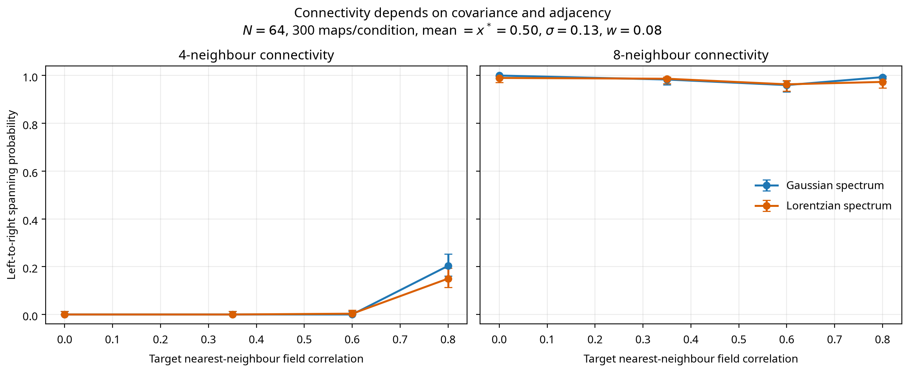
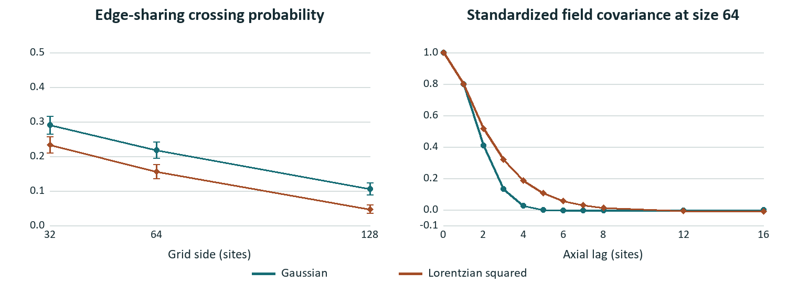

# Spatial Correlation and Connectivity Rules Govern Spanning in a Thresholded Random Field

## About the authors

Tejasv Sahu and Aaradhaya Gupta are independent student researchers in India. Their paper asks a question about the geometry of thin films: if two maps have the same number of favorable sites, how much does their arrangement matter? To study that question, the authors compare simulated maps with shuffled copies and count how often neighboring sites form a path across the grid.

### Tejasv Sahu

[ORCID 0009-0008-4301-3633](https://orcid.org/0009-0008-4301-3633)

### Aaradhaya Gupta

[ORCID 0009-0001-1160-6687](https://orcid.org/0009-0001-1160-6687)

## Abstract

Can two fields with the same mean and similar fractions of favorable sites differ in their probability of containing a connected path? We studied this question on 64 × 64 lattices using two random-field spectra, four target nearest-neighbor correlations, and 300 independent realizations per condition. We classified sites through a symmetric window around a fixed proxy value and tested each resulting map for a left-to-right crossing. Mean active fractions ranged from 0.46035 to 0.46181 across conditions. With edge-sharing connectivity, neither spectral family produced a crossing at zero correlation. At a target correlation of 0.80, 61 of 300 Gaussian-spectrum maps crossed (20.3%, 95% Wilson interval 16.2–25.2%), as did 45 of 300 Lorentzian-squared-spectrum maps (15.0%, 11.4–19.5%). Allowing diagonal contact changed the zero-correlation counts to 300 and 297, respectively. These results support a spatial effect on finite-grid crossing at comparable mean occupancy. Its magnitude depends on how connectivity is defined. In a separate 7,200-pair test at target 0.80, crossings remained more frequent on the original maps after exact occupancy matching, but became less frequent as grids grew from 32 to 128 sites per side. Neither family met the proposed finite-size convergence criterion. Application to nickelate films requires a calibrated local proxy and independent transport and magnetic measurements.

**Index terms** — Site percolation, spatial correlation, random fields, nickelate thin films.

## I. Introduction and Hypothesis

A film average discards the positions of the sites that contribute to it. Favorable sites could form compact, isolated regions or a narrow path joining opposite edges. That distinction motivates a question about reduction heterogeneity in infinite-layer nickelate films. If a local material state is favorable only within a finite window, how much can the arrangement of sites inside that window influence connectivity?

Percolation has been used to interpret the emergence of superconducting response in cuprates [[1]](https://doi.org/10.1038/s41467-018-06707-y), thickness-dependent transitions in cuprate films [[2]](https://doi.org/10.1038/s41598-020-60037-y), and spatially inhomogeneous pairing in disordered indium-oxide films [[3]](https://doi.org/10.1103/PhysRevB.78.014506). Nickelate studies provide experimental reasons to account for precursor cation stoichiometry and the reduction process [[4]](https://doi.org/10.3389/fphy.2021.719534), [[5]](https://doi.org/10.1002/advs.202309092). Whether the spatial statistics of reduction add predictive information beyond those measurements remains open.

The computational hypothesis is directional. At fixed proxy mean, dispersion, and window width, increasing the target nearest-neighbor correlation from 0 to 0.80 should increase the probability of an edge-sharing crossing in both spectral families while their mean active fractions remain comparable. The corresponding null hypothesis is equal endpoint crossing probabilities within each family. A secondary question concerns the same maps: how many additional crossings occur when corner contact is allowed? Because every edge-sharing path survives this change, the magnitude of the increase is the informative quantity.

## II. R&D Methodology

**Field generation.** We considered two non-negative power spectra, Gaussian and Lorentzian squared. Writing q for the spatial wavevector and ℓ for the spectral scale, the spectra are exp(−ℓ²|q|²/2) and (1 + ℓ²|q|²)⁻², respectively. Within each family, bisection selected ℓ to give a target nearest-neighbor correlation of 0, 0.35, 0.60, or 0.80 on the full periodic grid. Matching this statistic leaves the covariance at larger separations free to differ.

The spectral generator applied the square root of the selected power spectrum to Gaussian noise and inverse transformed the result on a 192 × 192 grid. We retained the central 64 × 64 crop, then recentered and rescaled it to zero mean and unit variance. Cropping separates the measured edges from the periodic boundary of the generating grid. The design comprised 2,400 fields in eight conditions, with seed streams derived from NumPy SeedSequence(53821) [[8]](https://github.com/tejasvswipe/superconductvity-nickelate-research/blob/267535fd908d3e235b5c46d0fefe744221cf16e7/spatial_covariance_sensitivity.py).

**Local activity.** At site i, the proxy was xᵢ = 0.50 + 0.13zᵢ, where zᵢ is the standardized field. A site was active when |xᵢ − 0.50| ≤ 0.08. For a unit-normal variable, the corresponding reference probability is erf[0.08/(√2 × 0.13)] = 0.461699. Each crop has the specified mean and dispersion, but the number of its values falling within the window can fluctuate. The design therefore controls the proxy moments exactly and compares active fractions empirically.

**Outcome and uncertainty.** A realization counted as spanning if an active component touched both the left and right crop boundaries. Four-neighbor connectivity allowed shared edges. Eight-neighbor connectivity also allowed shared corners. We evaluated both rules on each mask and estimated crossing probability as the number of spanning masks divided by 300. Wilson 95% intervals describe Monte Carlo uncertainty for each condition. The unit of replication was the field. The source reports eight passed implementation checks, including comparison of breadth-first search with union-find on 20 seeded masks under both adjacency rules. These checks address algorithm behavior within the model.

**Finite-size and exact-occupancy control.** We tested the highest correlation target (0.80) on 32, 64 and 128 sites per side, using two independent batches of 600 fields per spectrum and size. We retained the original proxy window, threefold padding and open crossing boundaries. For each standardized crop we uniformly permuted its binary labels and scored both the original and the shuffled mask under both adjacency rules. Every pair therefore has exactly the same active-site count. The count may vary between pairs. For the continuous standardized field we estimated covariance by averaging horizontal and vertical products over valid pairs at axial lags 1–8, 12 and 16. We evaluated the stated finite-size rule on pooled four-neighbor original-mask probabilities: absolute change below 0.02 at both doublings, and a Wilson 95% half-width of at most 0.03 at each size. This extension targets the partial-crossing regime identified by the initial study [[12]](https://github.com/tejasvswipe/superconductvity-nickelate-research/blob/17a8b7f801d3c105c6ebfdf49bf1fe5b6fae62b0/finite_size_control.py).

## III. Results and Analysis

**Table I. Left-to-right crossings out of 300 maps per condition.** G denotes the Gaussian spectrum and L the Lorentzian-squared spectrum. Columns 4 and 8 give the number of neighbors allowed [[9]](https://github.com/tejasvswipe/superconductvity-nickelate-research/blob/267535fd908d3e235b5c46d0fefe744221cf16e7/spatial_covariance_sensitivity.csv).

| Target correlation | G (4) | G (8) | L (4) | L (8) |
|---:|---:|---:|---:|---:|
| 0.00 | 0 | 300 | 0 | 297 |
| 0.35 | 0 | 295 | 0 | 296 |
| 0.60 | 0 | 288 | 1 | 289 |
| 0.80 | 61 | 298 | 45 | 292 |

The endpoint increase was 20.3 percentage points for the Gaussian spectrum and 15.0 points for the Lorentzian-squared spectrum. For comparison, the upper Wilson 95% bound for 0/300 is approximately 1.3%. Both families show the predicted direction, although even at 0.80 most fields lacked an edge-sharing crossing. Four correlation settings provide little resolution of the transition between rare and more frequent crossings.

Condition means for the active fraction spanned only 0.00146, or 0.146 percentage points. Thus the large endpoint change in crossings occurred with little change in average occupancy. The counts alone do not isolate an effect at identical occupancy in every realization. The 5.3-percentage-point difference between spectral families at 0.80 is descriptive. Overlap of their individual intervals does not test that difference.

Diagonal contact changed the zero-correlation result on the very same masks. It added 300 crossings in the Gaussian condition and 297 in the Lorentzian-squared condition, where neither had an edge-sharing crossing. Across all eight conditions, eight-neighbor counts ranged from 288 to 300. At 0.80, diagonal contact added 237 crossings in the Gaussian family and 247 in the Lorentzian-squared family. A rerun with the archived seeds reproduced the active-site count and both crossing outcomes for all 2,400 fields [[10]](https://github.com/tejasvswipe/superconductvity-nickelate-research/blob/267535fd908d3e235b5c46d0fefe744221cf16e7/spatial_covariance_sensitivity_replicates.csv).

**Fig. 1.** Left-to-right crossing probability on 64 × 64 maps. Bars give Wilson 95% intervals for 300 independent fields per point [[9]](https://github.com/tejasvswipe/superconductvity-nickelate-research/blob/267535fd908d3e235b5c46d0fefe744221cf16e7/spatial_covariance_sensitivity.csv).

**Earlier aggregate comparison.** A separate 64 × 64 study reported mean active fractions of 0.4613, 0.4622, and 0.4584 at correlation lengths of 1, 2, and 3 lattice units. Its reported crossing probabilities were 0.150, 0.980, and 0.988 [[11]](https://github.com/tejasvswipe/superconductvity-nickelate-research/blob/267535fd908d3e235b5c46d0fefe744221cf16e7/spatial_percolation_manuscript_and_data.txt). These aggregate observations show the same broad direction, but a length in lattice units and a nearest-neighbor correlation specify different properties. Pooling the studies would require an explicit mapping between generators. For the earlier 48 × 48 scan, the archived table omits the mean proxy for each row, and the original generator and individual map records were unavailable. The aggregate results therefore leave open how crossing probability varied with the mean proxy at a given correlation length.

**Table II. Finite-size control at target correlation 0.80.** Counts are out of 1,200 original–shuffle pairs per row. Intervals refer to original edge-sharing crossings [[13]](https://github.com/tejasvswipe/superconductvity-nickelate-research/blob/17a8b7f801d3c105c6ebfdf49bf1fe5b6fae62b0/finite_size_results/summary.csv).

| Size | Spectrum | Edge | Shuffled edge | 95% interval |
|---:|---|---:|---:|---|
| 32 | Gaussian | 348 | 1 | 0.265–0.316 |
| 32 | Lorentzian² | 279 | 1 | 0.209–0.257 |
| 64 | Gaussian | 261 | 0 | 0.195–0.242 |
| 64 | Lorentzian² | 186 | 0 | 0.136–0.177 |
| 128 | Gaussian | 126 | 0 | 0.089–0.124 |
| 128 | Lorentzian² | 56 | 0 | 0.036–0.060 |

The Gaussian series did not meet the convergence rule. Its absolute changes were 0.072 and 0.113, with a maximum Wilson half-width of 0.026. The Lorentzian-squared series did not meet the convergence rule. Its absolute changes were 0.078 and 0.108, with a maximum Wilson half-width of 0.024.

At size 64, mean axial covariance at lags 1, 2 and 4 was 0.799, 0.407, 0.024 for Gaussian fields and 0.798, 0.515, 0.185 for Lorentzian-squared fields. Agreement at the calibrated first lag coexists with measurable differences at longer lags. The supplement reports each batch, all measured lags, diagonal crossings and paired discordances.

**Fig. 2.** Left, pooled original-map crossing probabilities at target correlation 0.80 with Wilson 95% intervals. Right, mean covariance of standardized fields on the 64-site grid. Lag zero equals one by construction [[13]](https://github.com/tejasvswipe/superconductvity-nickelate-research/blob/17a8b7f801d3c105c6ebfdf49bf1fe5b6fae62b0/finite_size_results/summary.csv).

## IV. Discussion and Limitations

Changing the adjacency rule preserved every active site. It added links between corner-touching sites and raised the zero-correlation crossing counts from 0 to 300 and 297 in the two families. The exact-count shuffle further isolates spatial arrangement within each map. For a physical film, the relevant distance over which regions couple would have to be measured independently. Pixel size and corner contact alone do not determine current transmission.

The two size doublings provide a direct test of finite-grid stability at the most strongly correlated setting (Table II). Across the six size-by-family groups, only two of 7,200 shuffled controls had an edge-sharing crossing, both on the smallest grids. Original masks crossed more often at each tested size. The decline with size is evidence against treating the 64-site crossing probabilities as size-independent. The standardized finite-crop distribution and the axial covariance estimator also depend on crop size. The study does not establish the infinite-lattice limit or isotropy in measured films.

**Material-level hypothesis.** Spatial variation in reduction state may improve prediction of joint transport and diamagnetic response across independent growth batches. Two published observations motivate this test. Spatially resolved electron energy-loss spectroscopy distinguished regions with incomplete reduction in nickelate films [[6]](https://pmc.ncbi.nlm.nih.gov/articles/PMC7812792/). Scanning SQUID measurements mapped nonuniform diamagnetic response in superconducting nickelate films [[7]](https://doi.org/10.1103/PhysRevMaterials.8.024802). The reviewed records do not link a calibrated reduction map, transport curve and magnetic response to each film across independent batches. Combining observations from different studies would break that correspondence.

**Proposed validation protocol.** Within one composition and substrate platform, index every field of view, device and measurement by film and growth batch. Calibrate the reduction proxy against phase-identified reference regions, record its uncertainty and spatial resolution, and sample fields of view before examining outcomes. Estimate spatial variance and an axial correlation length on a common physical scale. Repeat maps to quantify measurement noise. Test whether transport along a defined direction agrees with paths identified on a registered map at that resolution.

Before evaluation, use a separate pilot to freeze the transport noise floor, magnetic background threshold, and temperature tolerance for a joint transition. Fit a baseline predictor using mean proxy, precursor composition, phase fraction and strain. Add the two spatial statistics to an otherwise identical predictor. Hold whole batches out, with all tuning confined to training batches. Report the decrease in mean squared probability error (Brier score), weighting each batch equally. Compare a batch-bootstrap interval with a pilot-defined minimum useful improvement. A lower bound above that minimum supports useful predictive gain. An upper bound below it counts against that prediction. Overlap leaves the test inconclusive.

The film records available for this study lacked a common identifier linking each calibrated reduction map to a resistance curve, a diamagnetic screening measurement, and an independent growth batch. We therefore could not estimate whether adding spatial reduction statistics improves prediction for films from a new batch. Whether connected regions in a reduction map carry superconducting current also remains open and would require a spatially registered measurement of current flow.

## V. Conclusion

At similar mean active fractions, increasing the target nearest-neighbor correlation from 0 to 0.80 raised edge-sharing crossing frequency from zero observed crossings to 61/300 and 45/300 in the two spectral families. Allowing corner contact made crossings common even at zero correlation. The matched-count shuffle and size series quantify how strongly this result depends on spatial arrangement and grid extent at the highest target. A direct nickelate test would ask whether measured spatial structure improves prediction of both transport and magnetic response in independent growth batches.

## Data and Code Availability

The archive provides the field generator [[8]](https://github.com/tejasvswipe/superconductvity-nickelate-research/blob/267535fd908d3e235b5c46d0fefe744221cf16e7/spatial_covariance_sensitivity.py), condition-level estimates [[9]](https://github.com/tejasvswipe/superconductvity-nickelate-research/blob/267535fd908d3e235b5c46d0fefe744221cf16e7/spatial_covariance_sensitivity.csv) and individual map outcomes [[10]](https://github.com/tejasvswipe/superconductvity-nickelate-research/blob/267535fd908d3e235b5c46d0fefe744221cf16e7/spatial_covariance_sensitivity_replicates.csv) used for Table I.

The finite-size supplement includes the simulation script [[12]](https://github.com/tejasvswipe/superconductvity-nickelate-research/blob/17a8b7f801d3c105c6ebfdf49bf1fe5b6fae62b0/finite_size_control.py), batch summaries [[13]](https://github.com/tejasvswipe/superconductvity-nickelate-research/blob/17a8b7f801d3c105c6ebfdf49bf1fe5b6fae62b0/finite_size_results/summary.csv) and 7,200 paired records [[14]](https://github.com/tejasvswipe/superconductvity-nickelate-research/blob/17a8b7f801d3c105c6ebfdf49bf1fe5b6fae62b0/finite_size_results/maps.csv). The reported run used NumPy 2.3.5.

## References

[[1]](https://doi.org/10.1038/s41467-018-06707-y) D. Pelc et al., “Emergence of superconductivity in the cuprates via a universal percolation process,” Nature Communications, vol. 9, art. 4327, 2018. DOI: 10.1038/s41467-018-06707-y.

[[2]](https://doi.org/10.1038/s41598-020-60037-y) H.-B. Jang et al., “Film-thickness-driven superconductor to insulator transition in cuprate superconductors,” Scientific Reports, vol. 10, art. 3236, 2020. DOI: 10.1038/s41598-020-60037-y.

[[3]](https://doi.org/10.1103/PhysRevB.78.014506) K. H. S. B. Tan, K. A. Parendo, and A. M. Goldman, “Evidence of spatially inhomogeneous pairing on the insulating side of a disorder-tuned superconductor-insulator transition,” Physical Review B, vol. 78, art. 014506, 2008. DOI: 10.1103/PhysRevB.78.014506.

[[4]](https://doi.org/10.3389/fphy.2021.719534) “Impact of cation stoichiometry on the crystalline structure and superconductivity in nickelates,” Frontiers in Physics, vol. 9, art. 719534, 2021. DOI: 10.3389/fphy.2021.719534.

[[5]](https://doi.org/10.1002/advs.202309092) A. Gutiérrez-Llorente et al., “Toward reliable synthesis of superconducting infinite layer nickelate thin films by topochemical reduction,” Advanced Science, vol. 11, art. 2309092, 2024. DOI: 10.1002/advs.202309092.

[[6]](https://pmc.ncbi.nlm.nih.gov/articles/PMC7812792/) “Doping evolution of the Mott–Hubbard landscape in infinite-layer nickelates.” https://pmc.ncbi.nlm.nih.gov/articles/PMC7812792/

[[7]](https://doi.org/10.1103/PhysRevMaterials.8.024802) “Scanning SQUID study of ferromagnetism and superconductivity in infinite-layer nickelates,” Physical Review Materials, vol. 8, art. 024802, 2024. DOI: 10.1103/PhysRevMaterials.8.024802.

[[8]](https://github.com/tejasvswipe/superconductvity-nickelate-research/blob/267535fd908d3e235b5c46d0fefe744221cf16e7/spatial_covariance_sensitivity.py) Spectral field generator and connectivity implementation. Project research archive, GitHub, revision 267535fd.

[[9]](https://github.com/tejasvswipe/superconductvity-nickelate-research/blob/267535fd908d3e235b5c46d0fefe744221cf16e7/spatial_covariance_sensitivity.csv) Crossing counts and Wilson intervals for the eight sensitivity conditions. Project research archive, GitHub, revision 267535fd.

[[10]](https://github.com/tejasvswipe/superconductvity-nickelate-research/blob/267535fd908d3e235b5c46d0fefe744221cf16e7/spatial_covariance_sensitivity_replicates.csv) Map-level records for the 2,400-field sensitivity experiment. Project research archive, GitHub, revision 267535fd.

[[11]](https://github.com/tejasvswipe/superconductvity-nickelate-research/blob/267535fd908d3e235b5c46d0fefe744221cf16e7/spatial_percolation_manuscript_and_data.txt) Archived manuscript and aggregate tables for the earlier correlation-length comparison. Project research archive, GitHub, revision 267535fd.

[[12]](https://github.com/tejasvswipe/superconductvity-nickelate-research/blob/17a8b7f801d3c105c6ebfdf49bf1fe5b6fae62b0/finite_size_control.py) Finite-size experiment and matched-occupancy shuffle implementation. Project research archive, GitHub, revision 17a8b7f8.

[[13]](https://github.com/tejasvswipe/superconductvity-nickelate-research/blob/17a8b7f801d3c105c6ebfdf49bf1fe5b6fae62b0/finite_size_results/summary.csv) Grid-size crossing counts, paired discordances and axial covariance summaries. Project research archive, GitHub, revision 17a8b7f8.

[[14]](https://github.com/tejasvswipe/superconductvity-nickelate-research/blob/17a8b7f801d3c105c6ebfdf49bf1fe5b6fae62b0/finite_size_results/maps.csv) Paired original and shuffled crossing outcomes for the 7,200-field experiment. Project research archive, GitHub, revision 17a8b7f8.
